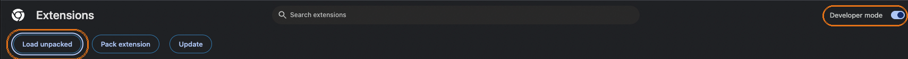

# Ad Library Collector — Chrome extension

Collects one advertiser's ads from the [Meta Ad Library](https://www.facebook.com/ads/library/) in
your own Google Chrome. It saves them as a file that you drop onto your dashboard's **Research**
page. That gives you each ad's creatives (videos, images, carousels) and copy, how long it has run,
Meta's impressions order, how many copies are live, partnership and "Low impression count" flags,
and measured media sizes.

You don't need a terminal to use it. It runs in your own Chrome, on your own connection, and
follows the pacing and daily limits described under [Limits and safety](#limits-and-safety).

- [Before you start](#before-you-start)
- [Install it in Chrome](#install-it-in-chrome)
- [Collect an advertiser's ads](#collect-an-advertisers-ads)
- [Import the file into your dashboard](#import-the-file-into-your-dashboard)
- [Options](#options)
- [Limits and safety](#limits-and-safety)
- [Troubleshooting](#troubleshooting)
- [Update or remove it](#update-or-remove-it)
- [For developers](#for-developers)

---

## Before you start

| You need | Notes |
|---|---|
| **Google Chrome 116 or newer** on a desktop (Mac or Windows), with **Developer mode left on** | Other Chromium browsers (Brave, Edge, Arc) usually work the same way but aren't tested. Chrome on phones doesn't support extensions. |
| **Access to your dashboard** | Wherever yours runs (on your own computer that's `http://localhost:3000`), signed in, with the product you're researching. |
| **Your normal internet connection** | Home or office Wi-Fi. Avoid VPNs and proxies: Meta limits those much sooner. |
| **The advertiser's Ad Library page or Page ID** | See [Find the Page ID](#find-the-page-id). |
| *Optional:* signed in to Facebook in the same Chrome | Only needed for age-restricted ads. See [Signed in or not](#signed-in-or-not). |

The extension comes ready to use with your dashboard. Nothing has to be built.

## Install it in Chrome

The extension isn't in the Chrome Web Store, so Chrome loads it from a folder on your computer.
You only do this once. It takes about two minutes.

### 1. Get the extension's folder

1. Open your dashboard → **Settings → Ad Library extension** (or your app's **Research** page →
   **How to get ads in, and stored media** → **Get the free extension**) and click **Download the
   extension**. That page has every step below with pictures. The zip is also at `/downloads/ad-library-extension.zip` on your
   dashboard's address (for example `http://localhost:3000/downloads/ad-library-extension.zip`), and
   in your copy of the repository at `studio/public/downloads/ad-library-extension.zip`.
2. Open the zip. On a Mac, double-click it; on Windows, right-click it → **Extract All**. You get a
   folder called **`ad-library-extension`** with `manifest.json` and the other files inside.
3. Move that folder somewhere it can stay, for example `Documents` (not inside the app's own
   folder). Chrome runs the extension from this folder every time it starts. If the folder is
   deleted or moved, the extension stops working.

*Working in the full source repository instead?* See [For developers](#for-developers).

### 2. Load it in Chrome

1. Type `chrome://extensions` in the address bar and press Enter. (Or use Chrome's ⋮ menu →
   **Extensions** → **Manage Extensions**.)
2. Turn on **Developer mode** with the switch in the **top-right** corner. Three buttons appear
   under the "Extensions" title:

   

   | Button | Use it? |
   |---|---|
   | **Load unpacked** | **Yes, this one.** It adds an extension from a folder. |
   | Pack extension | No. It turns a folder into a `.crx` package for publishing. |
   | Update | Not now. It re-reads the extensions you already have; use it after an [update](#update-or-remove-it). |

3. Click **Load unpacked**. In the window that opens, select the **`ad-library-extension`**
   folder from step 1 (click it once so it's highlighted) and click **Select**.
   - Choose the **folder**, not the `.zip` file and not a file inside the folder. The folder you pick
     must be the one that directly contains `manifest.json`. If you see a single folder inside
     another one with the same name, pick the inner one.
4. An **Ad Library Collector** card with the orange icon appears under **All Extensions**. Make sure its
   switch is on (blue).

If Chrome shows "Manifest file is missing or unreadable", you picked the wrong folder: go back to
step 3 and pick the folder that contains `manifest.json`.

### 3. Put the icon in the toolbar

Newer Chrome versions have a **Pin new extensions to Toolbar** switch above the extension cards.
If it's on, the orange extension icon is already next to the address bar. If you don't see it, click the
**puzzle-piece** icon (Extensions) to the right of the address bar, then the **pin** next to
**Ad Library Collector**.

### 4. Tell it where your dashboard is

The popup's **Open your dashboard** link opens your dashboard. It starts as `http://localhost:3000` (a copy
running on this computer). If yours runs somewhere else, open the popup, click **Change** next to
**Dashboard** at the bottom, type the address (for example `https://dashboard.example.com`) and click
**Save**. Leave the field empty to go back to `http://localhost:3000`. The address is kept in the
extension's own storage in this Chrome.

The extension only opens that address in a tab. It never sends it anything, so Chrome doesn't ask
for access to it: the file reaches the dashboard when you drop it on the Research page.

### What Chrome lists it can access

- **The Ad Library pages on facebook.com.** It reads them; it doesn't use the rest of Facebook.
- **Display information.** It finds the right edge of your screen for its small window.
- **Downloads.** It saves the file.
- **Notifications.** It tells you when a run is done.
- **Storage.** It remembers its limits, your last run and your dashboard's address.
- **Offscreen documents.** A hidden helper page turns big files (thousands of ads) into the download.

**Keep Developer mode on, always, not just for setup.** Chrome disables any extension added with
Load unpacked as soon as Developer mode is turned off, and keeps it disabled after a restart (tested
on Chrome 154). Turning Developer mode back on re-enables it straight away; nothing needs
reinstalling. Developer mode only adds the extra buttons on the Extensions page; it doesn't change
how Chrome behaves elsewhere.

## Collect an advertiser's ads

1. **Open the advertiser's page in the Ad Library.**
   1. Go to https://www.facebook.com/ads/library/.
   2. Choose a country (or "All") and the ad category "All ads".
   3. Type the advertiser's name and pick it under **Advertisers** in the suggestions. The top line,
      "Search this exact phrase", is a keyword search: it shows everyone's ads that mention the words.

   You're on the right page when the link contains `view_all_page_id=`.
2. **Click the orange extension icon.** The popup shows **Use this page** and Meta's number of ads for it
   (the "~290 results" on the page) and about how long reading all of them takes, e.g.
   "Meta shows ~290 ads: reading all of them, ~4 min". Click **Collect ads**. On any other page it
   says "This tab isn't Meta's Ad Library" (with **Open the Ad Library**); on the Ad Library before an
   advertiser is picked, "Pick an advertiser first". (You can also
   paste an Ad Library link or a Page ID into the popup from any tab.)
3. **A small collector window opens at the right edge of your screen** and loads the page there. A
   small panel in its corner shows the pages read, the ads found and the countdown to the next
   scroll. The extension scrolls by itself, slowly, like a person reading.
   - **You can keep working** in your main Chrome window or any other app. The only rule: **keep part
     of the collector window visible.** Chrome stops loading results in windows that are minimized or
     completely covered, and in background tabs. So the run pauses then, and carries on as soon as
     you bring the window back into view. Next to your main window, or on a second screen, is ideal.
     Don't close it until it's done.
   - If Meta's cookie dialog appears, the extension picks "Decline optional cookies" when that's offered.
     Otherwise it asks you to choose, and waits up to 5 minutes.
   - **Stop and save** (in the panel or the popup) ends the run early and still saves what it has.
4. **The file downloads by itself** when it's done, to
   `Downloads/Ad Library/<advertiser>-<page ID>-<date>.json`. A Chrome notification and the popup offer
   **Show in Finder**. The collector window stays open showing the result; close it whenever you like.

**How long a run takes.** It reads every ad to the end of the advertiser's list. The first results
page has about 30 ads; each scroll after it loads about 10 more (Meta's page size, checked in
November 2026), one every 9 seconds or so with the person-like pauses:

| Meta shows | Pages | About |
|---|---|---|
| 150 ads | 13 | 2 min |
| 1,000 ads | ~100 | 15 min |
| 9,000 ads | ~900 | 2 h 15 min |

Runs past about 45 pages are when Meta is most likely to pause a connection. For a big advertiser, a
quick look (**10** or **20** pages under **Ads to read**) reads its most-shown ads first.

**No duplicates.** Each ad (Library ID) is saved once, even when Meta lists it again further down,
so the file can come out a little under Meta's number. Ads that share a creative ("N ads use this
creative") are different ads with their own IDs and dates. They stay separate in the file, and your dashboard
groups them as copies on one card.

The popup's summary shows:
- how many ads were saved and how many are active;
- the videos, images and carousels;
- how many have Meta's "Low impression count" flag;
- partnership ads;
- age-restricted ads without creatives;
- what's new or gone since your last run on the same advertiser.

### Find the Page ID

The Page ID is the number after `view_all_page_id=` in the Ad Library link:

```
https://www.facebook.com/ads/library/?active_status=active&ad_type=all&country=ALL&search_type=page&view_all_page_id=102163941558548
                                                                                                                     └──── Page ID ────┘
```

It is **not** the number in the advertiser's Facebook profile link (`facebook.com/profile.php?id=…`).
A profile ID looks the same, but the Ad Library returns no ads for it. The easiest way is to open the
advertiser's Ad Library page and use **Use this page**.

### Signed in or not

- **Signed out of Facebook:** everything works, except that Meta hides age-restricted ads' creatives
  (prescription, other restricted categories). Those ads still come in, flagged, but without video,
  image, headline or link. The popup counts them.
- **Signed in to Facebook in this Chrome:** age-restricted ads come with their creatives. The runs are
  then tied to your Facebook account, so keep them occasional.

The extension never signs in for you and never reads your cookies or password.

## Import the file into your dashboard

1. Open your dashboard → your product → **Research**.
2. Drag `Downloads/Ad Library/<file>.json` from Finder onto the page. You can drop it anywhere on the page or on the dashed
   drop zone. Or click **Import file** and choose it.
3. Choose **Competitors** or **Our ads**, check the summary, and confirm.

Images and videos are copied into your dashboard's own storage in the background, because Meta's links expire
after a few days. Importing the same advertiser again updates its ads in place: decodes and Format
Library choices are kept, and media isn't downloaded twice.

## Options

| Option | Default | What it does |
|---|---|---|
| Country | `ALL` (or the page's own) | Ads shown in that country (a 2-letter code such as `US`, `GB`). |
| Active ads only | On | Off includes stopped ads too. |
| Ads to read | **20** | **All** reads to the end of the list. The run ends only when Meta says there are no more ads; when Meta stops sending them although it said more were coming (after 6 tries, nudging the page); at a block sign; or when you press Stop. **5 / 10 / 20 / 30** are quick looks: that many pages of the most-shown ads, since Meta lists those first (about 70 / 120 / 220 / 320 ads: 30 on the first page, 10 on each after it). Above 15 shows a warning. |
| Measure media sizes | Off | Measures the top 40 ads' video and image sizes after collecting (adds about a minute). That fills in each ad's size and nearest Meta placement in the file. Not needed for the dashboard, which measures an ad when you open it. |

The popup remembers your choices.

## Limits and safety

The Meta Ad Library limits visitors who load too much, too fast. The extension behaves like one
person browsing, and stops as soon as Meta pushes back.

- **One run at a time.**
- **Pacing:** it pauses 2.5–6 seconds before each scroll, sometimes 8–12, and waits for each page of results before the next.
- **Runs at least 30 minutes apart, at most 20 a day.** Going past either asks you to confirm first.
- **Long runs:** reading everything for a big advertiser (hundreds or thousands of ads) means hundreds of page
  loads in a row. That's when Meta is most likely to pause a connection; one public report put it at
  about 47 pages. If that happens, the run stops and saves everything it has (see below).
- **Stops at the first block sign:**
  - a rate-limit error;
  - a "You're temporarily blocked" notice;
  - a login wall or redirect;
  - results that stop arriving.

  It saves what it has, marks the file as incomplete and starts a **6-hour cooldown** that can't be
  skipped. The popup shows when the next run is possible.
- **What it never does:**
  - change your browser's identity;
  - use proxies;
  - solve CAPTCHAs;
  - sign in;
  - call Meta's API by itself. It only reads what the page you're looking at loads.
- **What it removes before anything is saved:** session tokens, cookies and who's looking (your account, recent searches).

Meta's terms (section 3.2.3) don't allow automated collection without its permission. This tool is
meant for occasional internal research on a few competitors. Keep runs small and rare. For large-scale
or external use, use Meta's official [Ad Library API](https://www.facebook.com/ads/library/api/), which
covers EU and UK ads.

## Troubleshooting

| What you see | What to do |
|---|---|
| **"Paused: the collector window is minimized or covered"** | Bring the small collector window back into view (any part of it is enough). Chrome doesn't load results in windows you can't see. The popup's **Show the window** does this. |
| **No count before the run** | The Ad Library page was open before the extension was installed or updated. Reload the page and open the popup again. The run still reads to the end; it shows Meta's total once it starts. |
| **"Meta stopped sending more results after N ads"** | Meta said more were coming but sent nothing after 6 tries. The file has everything up to there. Try again later. |
| **"Choose a cookie option on the page"** | Pick an option in Meta's cookie dialog. The most private one is fine. |
| **"No ads were collected" / 0 ads** | Check the Page ID (see [Find the Page ID](#find-the-page-id)). Open the link yourself: if the Ad Library shows no ads either, the advertiser has none in that country. Try `ALL`. |
| **"The page shows N ads but the extension couldn't read them"** | Meta changed its page. Nothing was blocked and no cooldown started. Tell the team so the extension can be updated. |
| **"Meta limited this connection" + a cooldown time** | Wait until the time shown. If it keeps happening, run less often, read fewer pages and turn off any VPN. |
| **"A run is already going in another tab"** | Finish or stop that run first. If its tab was closed, the run ends by itself within about a minute. |
| **"The Ad Library tab was reloaded mid-run"** | The run was lost. Start a new one and leave the tab alone while it runs. |
| **The file didn't appear / Chrome asked where to save** | If Chrome is set to "Ask where to save each file", it shows a dialog: save it anywhere and drag it from there. The popup's **Show in Finder** opens the file. |
| **The extension's icon isn't in the toolbar** | Click the puzzle-piece icon to the right of the address bar and pin **Ad Library Collector**. |
| **The extension's icon is gone or greyed out, or its card in `chrome://extensions` is switched off** | Developer mode was turned off, and Chrome disables Load-unpacked extensions without it. Turn **Developer mode** back on (top right of `chrome://extensions`) and the extension comes back. |
| **The card shows an error in `chrome://extensions`** | The folder you loaded was moved or deleted. Put it back, or load it again ([Install](#install-it-in-chrome), step 2). |
| **"Manifest file is missing or unreadable" when loading** | You picked the zip, a file, or the wrong folder. Pick the folder that directly contains `manifest.json`. |
| **Nothing happens when clicking Collect ads** | Make sure you're on a desktop Chrome window. Reload the extension in `chrome://extensions`, then reload the Ad Library tab. |

## Update or remove it

**Update to a new version:**
1. Get the new zip from **Settings → Ad Library extension** (after you update your dashboard) and open it.
2. Replace the **contents** of your existing `ad-library-extension` folder with the new files.
   Keep the folder in the same place, so Chrome keeps the extension's history and limits.
3. In `chrome://extensions`, click the **reload** arrow (↻) on the Ad Library Collector card, or the
   **Update** button at the top.
4. Reload any open Ad Library tabs.

Each new version of the dashboard carries the newest extension at the same link.

**Remove it:** click **Remove** on its card in `chrome://extensions`. Files it downloaded stay in
`Downloads/Ad Library`.

---

## For developers

This part is for people working in the full source repository. The copy of the extension that
comes with your dashboard is already built: you never need these steps to use it, and the files
named below are not in your copy of the dashboard's repository.

### Layout

```
chrome-extension/
  docs/                images used by this guide
  manifest.json        Manifest V3: content scripts on facebook.com/ads/library/*, background worker, popup
  build.mjs            esbuild → dist/ (load unpacked) + zip → studio/public/downloads/ad-library-extension.zip
                       (the zip unpacks to one ad-library-extension/ folder)
  tsconfig.json
  src/
    page-hook.ts       runs in the page's own JS world before Facebook's scripts; passes copies of the
                       page's POST /api/graphql/ responses (XHR and fetch) to the content script.
                       Requests/responses untouched; request reduced to name, doc_id, variables.
    content.ts         the run in the Ad Library tab: embedded first page, paced scrolling, block checks,
                       cookie dialog, media measuring, buildOutput
    background.ts      one run at a time, cooldown, daily ledger, per-page history (diff + early stop),
                       the download and the notification
    popup.html/.ts/.css  the toolbar popup
    widget.ts          the in-page progress panel (closed shadow DOM)
    offscreen.html/.ts the hidden page that turns the streamed file into a blob URL for the download
    ui-common.ts       logo, labels, time formatting, Ad Library URL rules shared by popup and panel
    protocol.ts        messages and state shared by all parts
  static/icons/        16/32/48/128 px icons
  test/e2e.mjs         end-to-end test (below)
```

The parsing is shared with the CLI scraper. That code lives in
`scripts/meta-ad-library/src/{parser,network,normalizer,rules,shared}.ts`, plus the engine's
`fromMetaLibrary` / `libraryDetails` in `supabase/functions/radar/engine/adlibrary.ts`. These modules
have no Node APIs, so both collectors write identical `radar.meta-ad-library/v1` files. Files from the
extension carry `"collector": "chrome-extension@<version>"`. Change the rules there, not in the
extension, and both stay in step.

### Commands (from the root of the source repository)

```bash
npm install                     # once: esbuild, playwright-core, @types/chrome
npm run build:extension         # chrome-extension/dist + the dashboard's zip
npm run watch:extension         # rebuild on change, then press reload in chrome://extensions
npm run typecheck:extension
npm run test:ad-library         # the shared parser and safety rules
node chrome-extension/test/e2e.mjs
```

`test/e2e.mjs` starts the installed Google Chrome with a throwaway profile and loads `dist/` through the
DevTools protocol (`--enable-unsafe-extension-debugging`). It then runs the extension against a mock
Ad Library made from the scraper's test fixtures: every facebook.com request is answered locally, so
nothing reaches Meta. It checks two runs:
- **A complete run:** embedded first page plus one GraphQL page loaded by scrolling, the file's contents,
  no session fields, media measured.
- **A rate-limited run:** stopped, partial file, 6-hour cooldown, next run refused.

### Releasing a new version

1. Bump `version` in `manifest.json`.
2. Run `npm run build:extension` and `node chrome-extension/test/e2e.mjs`.
3. Commit, including `studio/public/downloads/ad-library-extension.zip`. The dashboard's link
   serves the new version from its next release.
4. Anyone who already installed it replaces the contents of their folder and presses reload (see
   [Update or remove it](#update-or-remove-it)).
