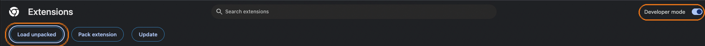
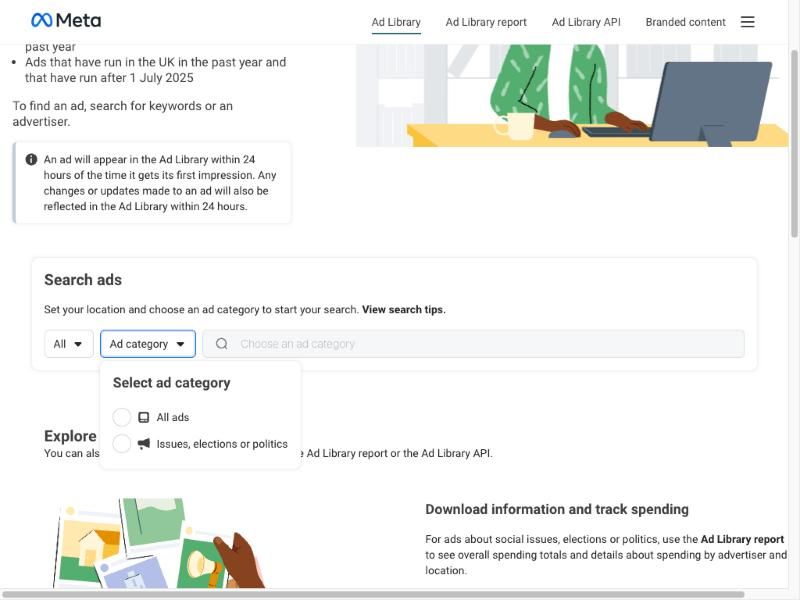
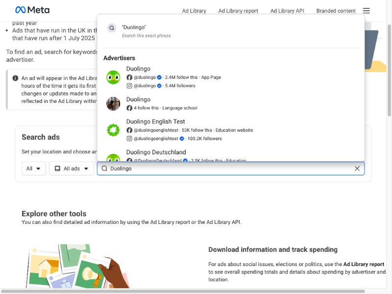
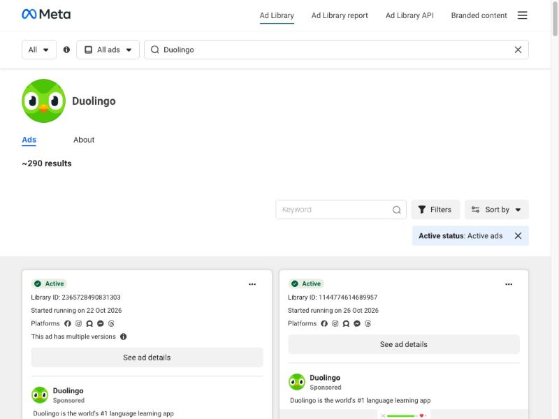
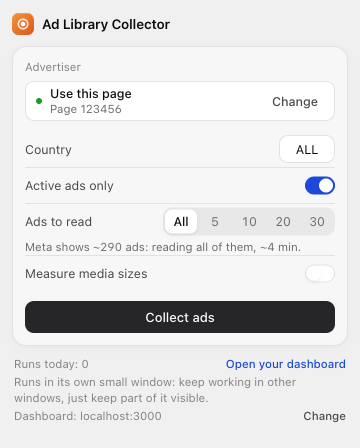
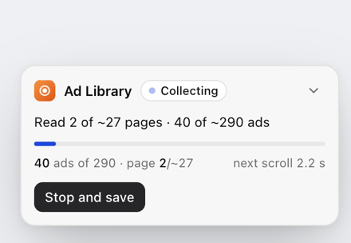
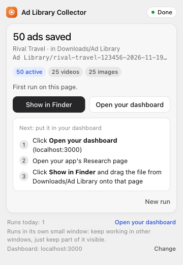
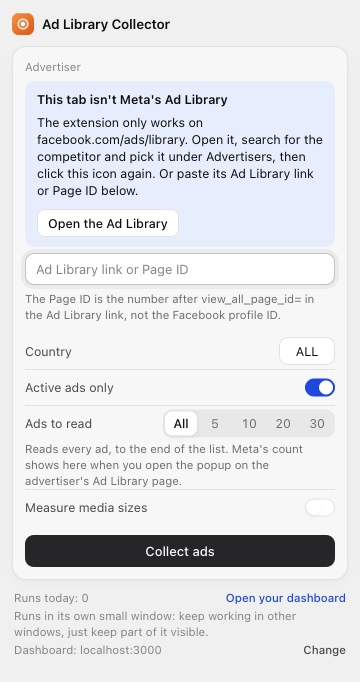

# The Ad Library extension (Chrome)

> **What this file is for:** installing the free Chrome extension that saves a competitor's ads from
> Meta's Ad Library into a file, and bringing that file into Benji GTM.
>
> **When to use it:** when you want a competitor's Meta ads (videos, images, copy, how long each has
> run) without paying for automatic collection. It needs no key and no password. Allow two minutes
> to install it, then a few minutes per competitor.

The same guide, with a **Download the extension** button and this dashboard's address ready to copy,
is in Benji GTM under **Settings → Ad Library extension** (the Research page's **Get the free
extension** opens it). Every option, limit and message is in
[chrome-extension/README.md](../chrome-extension/README.md).

- [Before you start](#before-you-start)
- [Install it](#install-it)
- [Collect a competitor's ads](#collect-a-competitors-ads)
- [Put the file in the app](#put-the-file-in-the-app)
- [What it can and can't do](#what-it-can-and-cant-do)
- [Update to a newer version](#update-to-a-newer-version)
- [If something goes wrong](#if-something-goes-wrong)

## Before you start

- **Google Chrome** on a Mac or Windows computer (version 116 or newer). Other Chromium browsers
  usually work but aren't tested. Phones can't run extensions.
- Benji GTM running (`bash start.command`, or your online copy), signed in, with the app you're researching.
- Your normal internet connection. Avoid VPNs: Meta limits them much sooner.

## Install it

Once per computer, about two minutes.

1. **Download the extension.** In Benji GTM, open **Settings → Ad Library extension** and click
   **Download the extension**. Chrome saves `ad-library-extension.zip` in your Downloads folder. (The
   same file is in your copy of the repository at `studio/public/downloads/ad-library-extension.zip`.)
2. **Open the zip and keep the folder.** Double-click it (on Windows: right-click it, then
   **Extract All**). You get a folder called `ad-library-extension`. Move it somewhere it can stay,
   such as Documents (not inside the app's folder): Chrome runs the extension from this folder, so
   don't delete or move it later.
3. **Open Chrome's extensions page.** Type `chrome://extensions` in Chrome's address bar and press
   Enter.
4. **Turn on Developer mode** with the switch at the top right of that page. Three buttons appear
   under the title. Leave Developer mode on: Chrome turns the extension off whenever it's off.

   

   *You only need **Load unpacked**.*
5. **Click Load unpacked and pick the folder.** Select the `ad-library-extension` folder itself (the
   one with `manifest.json` directly inside), not the zip, and click **Select**. An **Ad Library
   Collector** card with an orange icon appears, switched on.
6. **Pin it next to the address bar.** Click the puzzle-piece icon to the right of Chrome's address
   bar, then the pin next to **Ad Library Collector**. Its orange icon now sits beside the address bar.
7. **Give it this dashboard's address.** On the computer that runs Benji GTM at
   `http://localhost:3000`, there's nothing to do: that's what it starts with. For any other address
   (an online copy, another port), copy it from **Settings → Ad Library extension**, click the orange
   icon, click **Change** next to **Dashboard** at the bottom, paste it and click **Save**.

✅ **Checkpoint:** an **Ad Library Collector** card is on the extensions page, switched on, and the
orange icon is next to the address bar.

## Collect a competitor's ads

A few minutes per competitor. The pictures of Meta's Ad Library are from November 2026; Meta changes
its page now and then.

8. **Open Meta's Ad Library** at https://www.facebook.com/ads/library/. Choose a country (or
   **All**), then **Ad category** and **All ads**. You don't need to sign in to Facebook.

   

9. **Search for the competitor and pick it under Advertisers.** Type its name and click it in the
   **Advertisers** list. The top line, **Search this exact phrase**, is a keyword search: it shows
   every advertiser's ads that mention the words, not one competitor's.

   

10. **Check you're on its page of ads.** You see its name, about how many results there are and
    **Active status: Active ads**. The address contains `view_all_page_id=`. Shortcut: on the
    Research page, click **Open** next to a competitor to land here.

    

11. **Click the orange icon, then Collect ads.** The popup says **Use this page** and how many ads
    Meta shows. **Ads to read** starts at **20** pages (about 220 ads): Meta lists its most-shown ads
    first, and shorter runs are less likely to be stopped. Choose **All** only for a small advertiser.

    

12. **Let it run.** A small window opens at the right of your screen and scrolls by itself, about 10
    ads every 9 seconds. You can keep working in other windows, but keep part of this one visible:
    Chrome pauses windows that are minimized or fully covered. **Stop and save** ends early and keeps
    what it has.

    

13. **Find the file.** When it's done, Chrome shows a notification and the file is in
    `Downloads/Ad Library`, named after the competitor, its Page ID and the date (for example
    `rival-travel-123456-2026-11-19.json`). **Show in Finder** in the popup opens the folder.

    

✅ **Checkpoint:** the file is in your Downloads folder under `Ad Library`.

## Put the file in the app

14. **Drop it on the Research page.** In Benji GTM, open your app's **Research** page and drag the
    file from Finder anywhere onto it, or click **Import files** and choose it. Several files at once
    are fine. Choose whose ads they are (**Competitors** or **Our ads**), check the summary and confirm.
15. **Let the pictures and videos copy over.** The ads show at once. Their images and videos are
    copied into your own storage over the next minutes, because Meta's links stop working after a few
    days. Collecting the same competitor again later updates its ads in place.

✅ **Checkpoint:** the competitor's ads appear on the Research page.

## What it can and can't do

- **It only reads Meta's public Ad Library.** Chrome lets it open `facebook.com/ads/library` and
  nothing else. It doesn't read the rest of Facebook, your other tabs, your cookies or your history.
- **It never needs a password.** You don't sign in to anything to use it, and it never asks for a
  Facebook, Google or dashboard password. If something that says it's this extension asks for one,
  close it.
- **It sends nothing anywhere.** The file stays on your computer until you drop it on Research. The
  dashboard address is only used to open a tab.
- **Collect safely.** Meta limits connections that load too much, too fast. Collect one competitor
  at a time, at least 30 minutes apart and a handful a day, on your normal connection (no VPN). If
  Meta pushes back, the extension stops, saves what it has and waits 6 hours before the next run.

⚠️ Meta's terms don't allow automated collection without its permission. The extension behaves like
one person browsing and stops at the first sign Meta pushes back, but keep it to occasional research.

## Update to a newer version

When Benji GTM is updated, **Settings → Ad Library extension** offers the newest extension and
shows its version number; the card at `chrome://extensions` shows the one you have.

1. **Download it again** from that page and open the zip.
2. **Replace the files in your folder.** Copy the new files into your existing
   `ad-library-extension` folder, replacing the old ones. Keep the folder where it is, so Chrome
   keeps the extension's limits and history.
3. **Reload it in Chrome.** At `chrome://extensions`, click the round reload arrow on the Ad Library
   Collector card, then reload any open Ad Library tabs.

## If something goes wrong

- **The orange icon isn't next to the address bar:** click the puzzle-piece icon and pin Ad Library
  Collector. If its card at `chrome://extensions` is switched off or the icon is grey, Developer mode
  was turned off: turn it back on and the extension comes back.
- **"Manifest file is missing or unreadable":** you picked the zip, a file, or the wrong folder. Pick
  the folder that directly contains `manifest.json` (if there's a folder of the same name inside
  another, pick the inner one).
- **The card at `chrome://extensions` shows an error:** the folder you loaded was moved or deleted.
  Put it back, or do steps 2 and 5 again.
- **The popup says "This tab isn't Meta's Ad Library" or "Pick an advertiser first":** the extension
  only works on an advertiser's page of ads (steps 8 to 10). Click **Open the Ad Library** in the
  popup, pick the competitor under Advertisers, then click the icon again. If the count is missing on
  the right page, reload the page.

  

- **"Meta limited this connection" and a time:** Meta blocks fast or repeated runs for a while. The
  extension stopped without trying to get around it and kept what it had (that file imports as
  usual). Wait until the time shown, then collect less often, read fewer pages (10 or 20) and turn
  off any VPN.
- **"Paused: the collector window is minimized or covered":** bring the small window back into view;
  **Show the window** in the popup does it. It carries on by itself.
- **Research says the file isn't an ads file, or has no ads:** drop the `.json` file from
  `Downloads/Ad Library` as the extension saved it: don't open and re-save it, and don't change its
  name's ending. Files from other tools aren't accepted. A file with no ads means Meta showed none:
  check you picked the advertiser (not a keyword) and try the country All.
- **0 ads, or far fewer than Meta shows:** check the address has `view_all_page_id=` and try the
  country All. A run stopped early says why in the popup; the file still has everything up to there.
- More in [chrome-extension/README.md](../chrome-extension/README.md#troubleshooting).
